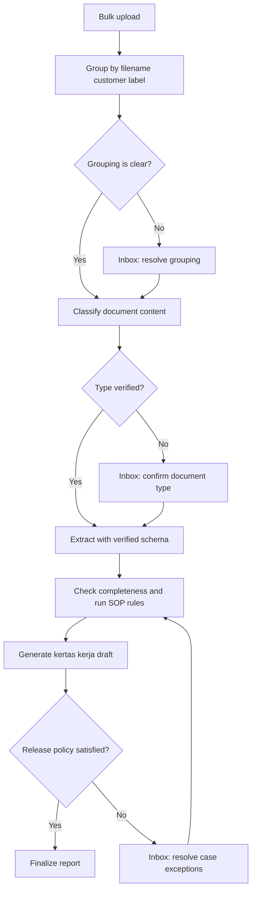

# v0.3 update

See [release notes](docs/RELEASE_0_3.md) for the current evidence/RIPLAY behavior and remaining tasks.

# Document automation platform · current implementation and plan

Updated 6 October 2026. The implementation guide below describes v0.2. The subsequent historical plan records earlier proposals and decisions; where status differs, the current guide takes precedence.

# SQE automation implementation · v0.2

This release adds the agreed document-only SOP workflow and Kertas Kerja reports to the existing FastAPI, Next.js, Temporal and MinIO platform. Source code and editable templates are included in this project.

## Start and exercise it

1. Extract the project and run `start.bat` on Windows or `bash start.sh` on Linux. Docker is needed for the default MinIO service. Compose starts Temporal; the local launcher uses the development-only database worker.
2. Sign in with organization **sqe**, email **sqe@bic.local**, password **P@ssw0rd2026**.
3. Open **Configuration → Processing defaults**. Use Fixture for a free synthetic demonstration, or save your LlamaCloud connector and use Llama. Fixture output does not describe the uploaded PDF.
4. Open **Automation** to edit supported upload limits, provider tiers, classification confidence and polling settings, plus report header metadata.
5. Open **SOP rules** to edit a rule using document and field dropdowns. Select an approved source and one of the four report categories. The reference field dropdown follows the selected document and operator type.
6. Use **Test settings** to replay stored documents and case SOP comparisons. Review the results, then **Publish settings**. Publication validates the entire draft again and rejects a stale expected version.
7. Bulk upload PDFs named `Customer Name_transaction.pdf`, `_lld.pdf`, `_invoice.pdf`, `_valas1.pdf`, `_valas2.pdf`, `_ektp.pdf` or `_riplay.pdf`. Filename customer labels can be corrected before upload. All originals and case membership are committed before any classifier starts.
8. After document extraction, the separate case SOP worker starts automatically. The case page displays run status, stage and snapshot hash, findings and scores.
9. Supply **Case context and transaction metadata** when needed, with a reason and supplied-document/page evidence. Saving queues a new SOP snapshot without a paid extraction job.
10. Download individual PDF/XLSX/JSON reports. Under **Kertas kerja**, select a branch to export its latest saved case reports as one XLSX row per case.

A published configuration applies to new cases. Existing cases keep their pinned configuration, including SOP rules. Publishing does not silently change an in-flight extraction or rewrite a previous report.

## Editable workbook

Use **Automation → Download editable XLSX template** to export the current configuration. `templates/forex-workflow-config-template.xlsx` is the initial starter example. The current export is the preferred basis for subsequent edits.

| Sheet | Editable content |
| --- | --- |
| General Settings | Provider, maker/checker, extraction version, report title and approved name directory |
| Workflow | Provider polling deadlines/read retries; supported parameter JSON; required registered actions and dependency order |
| Document Profiles | Labels, filename suffixes, parse/extract prompts and native validation policy JSON |
| SOP Rules | Approved source, category, typed fields, operator, conditions, currency companions and message |
| Case Templates | Template ID, display label and required document list |
| Report Context | Region, category, activity, inspection type and period header text |
| Field Catalog / SOP Scope | Read-only references; changing these does not register new fields or expand SOP scope |
| Lists / Read Me | Excel dropdown support and instructions |

The Excel field dropdown depends on its document cell. The UI additionally filters fields by operator type. The application schema has **no NIK/identity_number field**; an account number is never offered as its substitute.

Import produces a draft only. A workbook with any error is rejected as a whole, with sheet/row/cell details. Unknown fields, operators, source references, duplicate IDs, incompatible types, missing currency companions, bad JSON, formulas, unsupported step parameters and invalid workflow order are rejected. Imports are limited to 2 MB compressed, 20 MB expanded and 500 entries per editable sheet.

Bank administrators publish organization configuration. Branch administrators retain branch-scoped case operations and user administration; they do not publish organization rules. Officers can annotate/correct permitted case data. Reviewers can record SOP observations and release reports. Auditors are read-only. API authorization and CSRF protections apply independently of UI controls.

The ordered action registry is fixed: upload → group → classify → parse → extract → normalize/validate → case SOP → report → inbox. Required steps cannot be removed, disabled or reordered across dependencies. Presets declare supported behavior; arbitrary scripts, new backend actions, schema structure changes and a drag-and-drop screen layout designer are not part of this release. Adding a document field requires a registered engine schema/validator contract and a new configuration version. Extraction schemas and their hashes are stored in new profile configurations.

Generic case-template completeness gates stay separate from scored SOP controls; to score a document presence requirement, configure an eligible `document_required` rule.

Only provider polling deadlines/retries are editable runtime deadlines in the starter workflow; the other timeout cells are fixed preset metadata. Read retries never retry provider creation. The report format list can be edited in the workbook; JSON trace snapshots are always stored. Error policies and security/scope invariants are fixed by the registered presets rather than editable arbitrary behavior.

## Eligible SOP scope

The bundled catalog contains **29 source entries**:

- Consolidated SOP1/SOP2 Nos. **2, 4, 5, 6, 7, 9**, retaining both references.
- SOP5-RIplay Nos. **1, 2, 4, 5**.
- SOP4-Stempel Nos. **1, 3, 4, 5**.
- **All 15 SOP3 system checks**, as explicitly agreed even though SOP3 has no YES column.

CCTV, voice-recording verification, external SPIV/HO confirmation, SmartFX/CBS/Pega lookups, external signature specimens, physical stamp authenticity/inventory and actual employee/presenter authority checks are excluded from executable SOP checks and scores. An excluded requirement does not generate an SOP REVIEW or FAIL penalty.

A source instruction may contain both document observations and excluded requirements. Each source catalog entry records the retained document portion and excluded components. A document observation does not claim to verify the entire original control.

Native engine quality findings are preserved separately under **Document Quality** in XLSX and `technical_findings` in JSON. They do not enter SOP scores. Processing and classification errors still block final release. The standalone engine retains its full native validation behavior; the platform's SOP scope is a separate control layer.

### Supported comparisons and conservative outcomes

| Preset | Behavior |
| --- | --- |
| required / document_required | Checks one unambiguous completed document field or required document |
| match_exact | Case/whitespace-normalized text equality; identifiers retain character case and leading zeros |
| match_address / match_purpose | Exact normalized equality passes; different prose requires review rather than invented semantic equivalence |
| date_equal / date_on_or_after | Compares normalized valid DD-MM-YYYY dates |
| match_money | Compares positive Decimal principal values plus explicit ISO currency companions |
| signature_visible | Requires explicit visible handwritten/non-text and completeness observations with page/region evidence |
| all_pages_marked | Checks unique physical page observations, configured expected page count and bottom-right marks |
| stamp_present / stamp_placement | Checks document visibility/completeness and, when requested, signer-region placement |
| signature_visual_consistency | Remains REVIEW until a reviewer inspects both supplied document signing regions; presence booleans cannot pass it |
| policy_review | Retains unresolved policy/components transparently until an approved configuration or reviewed document observation resolves them |

Missing/ambiguous references and low-confidence sources produce REVIEW. Conditions with unknown case context produce REVIEW, not an assumed NOT_APPLICABLE. Neither signature identity nor physical stamp authenticity is inferred.

The initial rule package includes executable comparisons and explicit policy-review placeholders covering every eligible source entry. These placeholders are intentionally **not a claim of a completed bank-approved policy package**. Before ordinary automatic operation, an authorized bank administrator must configure the retained document controls and approve ambiguous mappings. Unresolved policy components can be recorded as case-specific document observations by reviewers, with provenance; they are not automatically passed.

### Explicit case context

The context form supports transaction direction, threshold state, customer type, identity type, declared carrier and payment basis, plus transaction inputter/approver names. An annotation records actor, reason, document evidence and time. It does not query external monthly turnover or infer a funding currency from the purchased currency.

Important policies remain explicit:

- SOP1 No.9 refers to invoice date, while SOP2 No.9 refers to due date. The starter package does not select one silently.
- SOP3 No.6 has an ambiguous sender/recipient ownership mapping. The starter rule remains REVIEW until an approved mapping is configured.
- SOP3 No.14 cannot compare invoice number numerically with an amount. Linkage and amount basis need distinct rules/observations.
- Valas 2 has no usage amount or purpose. SOP3 Nos.10 and 12 are NOT_APPLICABLE when only that declaration variant is present.
- Invoice comparisons use explicit FULL_INVOICE or PROGRESS_CLAIM basis. Progress claims compare claim amount/currency; partial payments require review and a separately approved basis.
- Individual identity requirements must be configured for the individual or authorized representative; a company is not itself an eKTP holder.

## Case processing and traceability

`DocumentWorkflow` continues to run document activities in parallel. Completion queues `CaseRun` only when no document remains active. `CaseSOPWorkflow` then evaluates frozen inputs and writes report artifacts. The Temporal ID is `sop-{case_id}-{snapshot_hash}-{configuration_version}`. The development runner uses leased, conditional database claims for both job types.

The snapshot includes membership, document hashes, raw/normalized values, overrides, metadata, provider IDs, pinned configuration/schema hashes and context. The worker rechecks the fingerprint before evaluation and before publication. Superseded runs do not publish a stale current report. Identical input reruns are idempotent.

Field corrections use stored raw extraction. **Rerun SOP checks** uses stored normalized values and rules; neither action creates another paid extraction. Context changes create a new snapshot/report revision. A failed SOP/report activity is visible in case progress and inbox; retry resumes the case job, preserving completed document extraction. Paid provider submissions retain their existing checkpoint/reconciliation behavior.

A reviewed observation records PASS/FAIL, rationale, actor and supplied-document/page/region references. Signature consistency requires both relevant document observations. Decisions are bound to the document/configuration fingerprint. Changing document inputs prevents an old observation from being reused; changing case context clears prior observations. The original automated REVIEW remains traceable in the report.

The UI polls while visible, refreshes on focus, shows pending actions and notifications, and leaves worker processing independent of the browser. This release uses polling rather than SSE.

## Kertas Kerja

The main XLSX follows the supplied A–T layout and header context. It excludes original sample customers, discussion notes and invalid fixed total ranges. One case occupies one row and **Data Count = 1**. Account numbers remain strings.

| Columns | Source / meaning |
| --- | --- |
| A–C | Row number, confirmed finding status and case count |
| D–F | Remitter/customer name, remitter account and transaction type |
| G–I | Explicit transaction inputter/approver and declared carrier; never substituted with uploader/platform reviewer |
| J–K | Transaction date and SOP inspection date |
| L–M / N | Data Completion, Customer Signature / Total A |
| O–P / Q | Document Completion, Officer Review & Approval / Total B |
| R | Overall score |
| S | Original BIC Remarks: blank and hidden |
| T | Deterministic categorized Product Remarks from eligible findings |

A category is **0** for any confirmed eligible FAIL, **1** when all applicable checks resolve PASS, and blank for unresolved REVIEW/ERROR/no applicable controls. A confirmed zero dominates aggregates; otherwise unresolved operands leave totals blank. NOT_APPLICABLE is omitted from the scored set. Only eligible active SOP findings affect scores.

Scores and summary percentages are numeric server-computed values, not formulas requiring Excel recalculation. Percentages use scored cases as the denominator. Total cases, scored cases and unresolved cases are displayed together. A branch export uses each case's latest **saved** report snapshot, so it can include drafts and older snapshots while a new revision is processing; review its state/configuration/hash in Report Trace and SOP Details.

Additional sheets retain all SOP results including PASS, source/scope/category, actual/expected values, evidence, native document quality, extracted/raw/override values and report trace. Individual reports have immutable versioned PDF/XLSX/JSON artifacts in MinIO. Branch XLSX exports store a manifest of report IDs/versions/hashes and an audit record.

Report finality is separate from compliance: an authorized reviewer may release a completed report containing confirmed FAIL findings. Missing required documents, processing errors or unresolved SOP reviews block release. Maker/checker separation applies when configured. Final release does not erase violations.

## API additions

- `GET /api/config/catalog` — typed fields, eligible source catalog, operators and context options.
- `GET /api/config/export` — current editable XLSX; bank administrator.
- `POST /api/config/import` — multipart XLSX → validated draft or row/cell errors; bank administrator.
- `POST /api/config/test` — native replay plus case SOP replay, without paid jobs or publication.
- `PUT /api/cases/{id}/context` — audited values/reason/evidence → new case SOP snapshot.
- `POST /api/cases/{id}/sop-rerun` — idempotent rerun/retry using stored extraction.
- `POST /api/cases/{id}/sop-review` — reviewer decision with supplied-document observations.
- `GET /api/reports/kertas-kerja?branch_id=...` — scoped branch XLSX and stored export manifest.

## Upgrade

Back up the database and MinIO, stop API/workers, and run `python backend/migrate_profiles.py` using the configured project environment. The script publishes missing profiles and the new automation configuration as a **new version** without modifying historical versions. API startup creates the two additive tables (`case_contexts`, `case_runs`); no existing columns are rewritten. Development startup upgrades automatically for the development organization.

Historical cases keep their legacy workflow/report behavior. New automation cases require a new upload using the upgraded version. A production deployment should replace development `create_all` with its controlled database migration process. Existing immutable report snapshots remain readable.

## Verification and boundaries

See `VERIFICATION.md` for this build's checks. Fixture and mocked provider tests do not establish OCR accuracy. Real LlamaCloud extraction must still be evaluated with the bank's samples and scoped API key. Docker/real PostgreSQL/MinIO deployment testing and Windows launcher execution are not asserted by the isolated tests.

Production SSO, PostgreSQL RLS, approved infrastructure/retention, quotas, a visual page-layout designer and advanced inbox assignment/SLA controls remain deployment work. External verification is explicitly outside this SOP scope. The supplied source workbooks establish the controls and report mapping; they do not supply all master lists, policy interpretations or visual authenticity evidence.

---

# Historical architecture plan and design decisions

# Document Automation Platform — Architecture and Implementation Plan

Date: 6 October 2026  
Status: Architecture plan with development decisions confirmed on 6 October 2026.

This document consolidates the platform plan and explanations from our discussion. It describes the intended design; it does not claim that these platform components have already been implemented.

## 1. Goal and operating model

Build a case-based automation platform for a multi-branch bank.

The user uploads a batch of customer documents. The platform organizes the files into customer transaction cases, classifies each document, runs extraction and SOP_CHECKS, and prepares a kertas kerja. The inbox brings together exceptions that need action.

The current Python engine becomes the processing core. Retain its schemas, prompts, normalization and validation logic, then add orchestration, permissions, configuration and a Next.js interface around it.

### Required platform outcomes

- API backend separate from background processing.
- Multiple parallel worker processes.
- Production-quality code that remains maintainable and traceable.
- Configurable business rules, document profiles, workflows and layouts.
- RBAC supporting users with permissions across one or more branches.
- Automatic workflow execution after upload.
- Responsive UI with visible upload and processing states.
- Persistent notifications and an inbox that acts as the user cockpit.
- Kertas kerja reports backed by recorded findings and evidence.

### Existing document profiles to carry forward

| Profile | Document |
| --- | --- |
| Application form | Application of Transaction |
| LLD | Lalu Lintas Devisa document |
| Underlying invoice | Invoice and payment details |
| Valas 2 | Surat Pernyataan Pembelian Valas 2 — Paling Banyak Sebesar Jumlah Threshold |
| Valas 1 | Surat Pernyataan Pembelian Valas 1 — Diatas Jumlah Threshold |
| eKTP | Electronic identity card |

Existing field definitions and rules remain the starting point. Add new profiles through the same configuration and processing contracts.

Each uploaded file represents a document. Document splitting is outside the initial scope.

## 2. Make the transaction case the central object

A customer can have multiple transactions. Documents therefore belong to a case, rather than being grouped by customer name alone.

| Object | Purpose |
| --- | --- |
| Upload batch | Tracks one bulk upload and every file received |
| Document | Stores the original file, classification, extraction and evidence |
| Case | Groups documents for one customer transaction |
| SOP evaluation | Records checks, findings and their rule versions |
| Report | Stores a versioned kertas kerja |
| Inbox item | Assigns an action or notification to an authorized user |

The expected 4–7 documents become a configurable case template. Some documents may be mandatory only under certain conditions. The platform must not assume that every case requires all supported document types.

### Confirmed grouping and classification order

The development flow is: **group by filename customer label first, then run LlamaCloud Classify for every document, then select the verified extraction schema.**

- The customer name labeled in each filename determines case grouping.
- Grouping is scoped to the authenticated organization, selected branch and current upload batch.
- Normalize case and redundant spaces for matching; do not use fuzzy name merging.
- Filename document labels provide a routing hint, not the final extraction decision.
- All document memberships are persisted before any classification work is queued.
- LlamaCloud Classify verifies document content and selects its supported document type.
- Unknown types, low-confidence classifications and filename/content conflicts require review before extraction.
- Classification does not decide case membership or regroup files by extracted customer names.
- Later uploads create new cases unless the user explicitly attaches them to an existing case.
- The upload preview allows correcting the customer label before submission.

Examples: `poko_transaction.pdf`, `poko_lld.pdf` and `poko_invoice.pdf` belong to the same Poko case within one branch and batch. `Forex - Poko - Aplikasi Transaksi.pdf` uses an approved document label and groups with the same customer.

This keeps separate transactions for a repeated customer from being merged across batches. If one batch includes multiple transactions for the same customer, distinct case labels or a transaction reference will be needed; name alone cannot distinguish them.

## 3. Recommended stack and deployment architecture

| Component | Recommendation | Responsibility |
| --- | --- | --- |
| Frontend | Next.js, TypeScript, Tailwind | Uploads, cockpit, case review and configuration |
| API | Python FastAPI | Authorization, case management, configuration and queries |
| Workflow orchestration | Temporal | Durable processing, retries, waiting and resuming |
| Workers | Separate Python worker deployments | Classification, extraction, SOP checks and reporting |
| Database | PostgreSQL | Business records, configuration, findings, audit and inbox |
| File storage | MinIO private object storage | Original documents and generated artifacts |
| Identity | Enterprise SSO through OIDC | Login, memberships and role assignments |
| Observability | Structured logs, metrics and traces | Follow a case across API, workers and providers |

Start with one modular codebase. Deploy the API and worker pools independently so processing capacity can scale separately.

Avoid creating a separate microservice for every document type. Document-specific behavior belongs in profiles and domain modules unless operational requirements later justify another service boundary.

Temporal is the recommended durable orchestration component because these workflows can outlive an HTTP request, wait for missing documents or review, and resume after infrastructure failures. It adds an infrastructure component, but avoids building a custom workflow recovery engine.

PostgreSQL holds business state and the UI read model. Temporal holds workflow execution history. Define ownership clearly so there are not two competing workflow coordinators.

Redis can be introduced for caching, rate limiting or live-event fan-out if needed. It should not be the sole durable record of a job or notification.

### Preserve the existing engine

Refactor the current engine into reusable modules:

- Document profiles, schemas and prompts.
- Provider adapters.
- Classification and grouping policies.
- Normalization and supported corrections.
- SOP evaluation.
- Evidence and provenance.
- Export and report generation.

The CLI remains a useful development and regression harness. API handlers and workers call the same core logic rather than launching CLI subprocesses.

Pin provider SDK versions and test compatibility before upgrading.

## 4. Automatic workflow

### Processing sequence

1. Receive and validate the upload.
2. Persist original documents and create tracking records.
3. Group all files by filename customer labels and persist case membership.
4. Classify every document and resolve unknown types or filename/content conflicts.
5. Extract documents independently and in parallel using the verified schema.
6. Normalize values and run field/document checks.
7. Evaluate case completeness and cross-document SOP rules.
8. Generate a kertas kerja draft, including unresolved findings.
9. Release automatically when the configured policy permits, or route exceptions and approval actions to the inbox.
10. Finalize a versioned report.

A missing document should not prevent useful extraction from the documents already available. The case can remain waiting for documents while partial results and a draft report are visible.

When a missing or corrected document arrives, reevaluate affected rules and regenerate the report. Avoid reprocessing unrelated documents unnecessarily.

### Workflow organization

Use a case workflow to coordinate document workflows. Each document progresses independently. A slow invoice should not stop another case from finishing.

Worker task queues can separate classification/extraction, SOP evaluation and report generation. Initially, some worker pools can share deployment resources; their execution contracts should still be separate.

Use short polling activities and durable waiting where appropriate rather than occupying worker slots with long blocking provider polling loops.

## 5. Parallel processing and reliability

Concurrency should be configurable by provider, bank and branch. Apply fair scheduling so one large upload does not monopolize processing.

Capacity controls should include:

- Provider rate and concurrency limits.
- Worker concurrency.
- Branch scheduling fairness.
- Queue backpressure.
- Timeouts and retry budgets.
- Provider credit or processing-budget policies where available.

### LlamaCloud integration

Retain uploaded file IDs and provider job IDs. Classification can return a document type, confidence and reasoning, and supports input through an existing parse job.

Reuse compatible parsing results where supported. Document-specific requirements may still justify another parse; do not assume every profile can always share one parsing configuration.

Keep provider-specific request logic behind an adapter so the domain engine is not coupled to SDK response shapes.

### Retry and recovery rules

- Persist each stage's inputs, provider identifiers and outcomes.
- Retry transient failures with bounded backoff.
- Treat authentication failures and invalid configuration as actionable errors.
- Reconcile an uncertain submission before creating another paid provider job.
- Resume completed stages instead of restarting the whole case.
- Use stable idempotency keys where the provider supports them.
- Guard persistence and artifact creation against repeated activity execution.

Durable orchestration does not make external API calls automatically exactly once. Retried activities can execute more than once. Submission and persistence logic must account for repeated execution.

The API should durably record accepted work before acknowledging it. A transactional outbox or equivalent reliable handoff can connect accepted uploads to workflow startup.

### Processing status versus validation status

Keep these dimensions separate.

Examples of processing states:

- Queued
- Running
- Waiting for documents
- Waiting for review
- Retry scheduled
- Completed
- Processing error
- Cancelled

Examples of validation results:

- PASS
- FAIL
- REVIEW
- NOT_APPLICABLE

A successfully extracted document can contain failed SOP checks. That is a completed processing outcome with business findings, and it should still produce useful outputs.

## 6. SOP_CHECKS as a versioned rule engine

| Layer | Examples |
| --- | --- |
| Case completeness | Required documents, duplicates and conditional requirements |
| Field quality | Date, enum, NIK, currency, account format and unreadable values |
| Document consistency | Invoice arithmetic, date relationships and required signatures |
| Cross-document consistency | Customer identity, beneficiary account, currency and transaction references |
| Reference and external checks | Bank master lists, purpose codes, calendars and verification services |

Cross-document comparisons need explicitly defined relationships. For example, differing currencies should trigger the configured currency/FX rule rather than a simple amount-equality check.

### Finding contract

Each finding should record:

| Attribute | Meaning |
| --- | --- |
| Rule ID and version | Which rule produced the finding |
| Scope | Field, document or case |
| Affected fields | Inputs relevant to the check |
| Actual value | What the engine evaluated |
| Expected condition | Rule requirement or reference value |
| Result | PASS, FAIL, REVIEW or NOT_APPLICABLE |
| Severity | Blocking, warning or informational policy |
| Evidence | Source document/page/region when available |
| Suggested action | The next supported resolution |
| Evaluation metadata | Time, run ID and configuration snapshot |

Result and severity are separate. A finding's disposition determines whether it blocks report release.

### Raw, normalized and effective values

Preserve three value layers:

1. Raw: exactly what extraction returned.
2. Normalized: approved formatting and mapping.
3. Effective: the value accepted after review or permitted correction.

For EAST WEST PANK, an approved alias can produce a traceable correction to EAST WEST BANK. A fuzzy suggestion should retain the original text and supporting evidence until configured acceptance conditions are satisfied.

Do not silently overwrite extracted values. Record the correction method, evidence, confidence or decision basis, and reviewer identity when applicable.

### Role of AI and deterministic logic

Use deterministic logic for required fields, valid enums, calculations, date constraints and master-list checks.

Use AI for document observations, context interpretation and explanations where helpful. AI-generated explanations must remain consistent with recorded findings and must not invent a business PASS.

Signature, photo and stamp checks should record visual observations separately from authenticity verification. Detecting a visible stamp or signature is not sufficient evidence of authenticity. Missing verification evidence remains REVIEW when that verification is required.

## 7. Business configuration and governance

Provide configuration pages for:

- Document profiles, schemas, prompts and processing tiers.
- Case templates and conditional document requirements.
- Classification and grouping rules.
- SOP rules and tolerances.
- Master lists and bank calendars.
- Review thresholds and permitted corrections.
- Routing, SLAs and notifications.
- Report templates and release policies.
- Roles, branch memberships and access scopes.
- Supported table columns, filters and dashboard layouts.

### Rule builder

Common operators should be available through a guided rule builder:

- Required or conditionally required.
- Matches an enum or master list.
- Equals another field.
- Within numeric tolerance.
- Quantity multiplied by unit price.
- Sum of line items.
- Date ordering or allowed calendar date.
- Document present.
- Approved alias mapping.

Specialized algorithms remain reviewed code modules. Do not execute arbitrary Python supplied through an administrator form.

### Configuration lifecycle

Draft → Test → Publish → Retire

Testing should replay representative samples and show how the proposed configuration changes findings. Introduce configuration publication approval where bank policy requires it.

Each case pins its configuration versions. Publishing a new rule must not silently change an existing report. Reprocessing creates a new evaluation and report version.

Allow rollback for future processing. Preserve the configuration used by historical runs.

### Secrets and infrastructure settings

Credentials belong in controlled connector settings backed by a secret store, with masked display and audited changes.

Business settings should not require frequent environment-variable edits. Deployment bootstrap, secret references and infrastructure settings can remain controlled operational configuration.

## 8. Multi-branch RBAC

Use roles and access scopes together.

| Role | Typical access |
| --- | --- |
| Bank administrator | Bank-wide configuration and authorized administration |
| Branch administrator | Branch users, assignments and permitted operational settings |
| Officer / maker | Upload and manage authorized cases |
| Reviewer / checker | Resolve findings and approve within assigned scope |
| Auditor | Read authorized reports, evidence and history |

A user may belong to multiple branches with different permissions. Evaluate permission against the requested action and resource scope.

Maker–checker separation can prohibit approving one's own case where bank policy requires it.

### Enforcement boundaries

Authorization must cover:

- API endpoints and returned records.
- Document previews and original-file downloads.
- Report downloads.
- Inbox items and assignments.
- Live-event subscriptions.
- Search and exports.
- Administrative configuration.
- Worker operations using explicit bank and branch context.

PostgreSQL row-level security provides an additional enforcement layer. Application database connections should use roles that do not bypass those policies.

File access should use authorized, time-limited access paths. Knowing a file identifier must not grant access.

Record changes to memberships, approvals, effective values, overrides and configuration in the audit history.

## 9. UI and UX plan

Use Next.js with TypeScript and Tailwind. Incorporate your Tailwind PRO assets during implementation.

The interface should be corporate, smooth and oriented around the case, with minimal navigation required to resolve a finding.

| Screen | User experience |
| --- | --- |
| Cockpit / inbox | Prioritized actions, processing overview and overdue cases |
| Bulk upload | Drag-and-drop, per-file progress and automatic processing |
| Cases | Searchable, filterable status list |
| Case workspace | Document preview, extracted values, findings and evidence |
| Reports | Draft/final versions and downloads |
| Configuration | Guided settings, testing and publication |

### Case workspace

Provide:

- Case summary and completeness status.
- Document inventory with stage statuses.
- Document preview beside extracted values and findings.
- Evidence navigation to the relevant source page or region when available.
- Inline actions for attaching a document, correcting grouping, accepting a supported correction and reviewing a failed check.
- Processing timeline and audit history.

Show one consolidated set of case exceptions. Avoid making the user navigate separate review screens for every processing stage.

### Responsive processing experience

- Separate upload progress from processing progress.
- Return a tracking ID without waiting for extraction.
- Continue processing when the user navigates away.
- Show queued, running, retrying, waiting and failed states explicitly.
- Use concrete counts and stages rather than invented percentages.
- Reconnect live updates and recover missed events.
- Provide polling as a fallback.
- Show immediate loading states during navigation.
- Paginate or virtualize large lists and load heavy document previews on demand.

Example progress message:

> 18 of 32 documents extracted. Three cases are waiting for documents. Two cases require review.

Next.js route loading conventions and streaming help provide immediate loading UI. Backend processing must remain asynchronous independently of frontend loading behavior.

### Notification and inbox model

| Channel | Purpose |
| --- | --- |
| Inline finding | Explains a field or case issue next to its evidence |
| Toast | Brief acknowledgement or completion update |
| Persistent inbox | Tracks assigned actions and important case events |

Group related findings into case actions rather than sending one notification per field.

Inbox items should carry branch scope, owner/assignee, severity, due time, source case, deduplication identity and next action.

Reading an inbox item does not resolve it. Unread, acknowledged and resolved are separate states.

Keep routine progress in the cockpit and processing view. Use persistent action items for missing documents, ambiguous grouping, failed checks, approvals and processing errors that need intervention.

### Configuration UX

Use plain-language labels, sensible defaults, profile-specific forms and advanced settings that expand when needed.

Show a preview of how a rule behaves against an example. Master-list imports should be validated before publication.

The initial configurable layout scope should cover columns, saved filters, dashboard panels and report sections. Broader layout customization can grow later without requiring a general-purpose page builder.

## 10. Kertas kerja and output design

Generate the report from a structured evaluation snapshot containing:

- Case, customer and branch details.
- Document inventory and processing versions.
- Rule results, actual values and expected conditions.
- Calculations and source evidence.
- Corrections and reviewer decisions.
- Approval history and unresolved exceptions.

Generate a draft even when checks fail, clearly showing unresolved findings. Final release follows the configured approval policy.

PDF and Excel are sensible initial formats. Add other formats if required by the approved report template.

Report wording and calculations must be reproducible from the evaluation snapshot. Optional AI explanations must not alter the underlying decision.

### Versioning

- Preserve each report's source evaluation and configuration versions.
- Record who reviewed and released the report.
- Regeneration produces a new report version.
- Retain prior versions and their audit history.

### CSV grouping

Preserve the existing expectation that extraction outputs are grouped by document type.

- Maintain per-document results.
- Produce aggregate extraction CSV outputs separately for each document type.
- Include case, branch, source document and evaluation references for traceability.
- Keep case-level SOP/report summaries separate from the document-type extraction datasets.

Do not flatten every document type into one mixed extraction CSV.

## 11. Maintainability and traceability

Use clear module boundaries between API transport, workflow coordination, domain logic, provider adapters and persistence.

Every processing attempt should be traceable through:

- Batch ID.
- Case ID.
- Document ID.
- Workflow and evaluation/run IDs.
- Provider file and job IDs.
- Schema, prompt, provider and rule versions.
- Report version.
- Actor and branch scope.

Use structured logs, metrics and distributed tracing. Avoid logging raw customer documents, secrets or complete sensitive field values by default.

Generate or validate the frontend API client against the backend contract so the UI and API remain aligned.

Useful operational metrics include queue age, stage duration, provider failures, retry counts, manual-review rate, case completion rate and report-generation failures.

## 12. Implementation sequence

| Phase | Deliverable |
| --- | --- |
| 1. Foundation | Case model, branch authorization, storage, configuration versions and workflow contracts |
| 2. Complete vertical slice | One representative case from bulk upload through extraction, SOP checks, inbox and draft report |
| 3. Business coverage | Existing six document profiles, cross-document rules, configuration UI and review workflow |
| 4. Production readiness | Recovery, provider-limit handling, branch-isolation tests, load tests and operational monitoring |

### Phase 1: Foundation

Define the domain models, API boundaries, worker contracts, authorization and storage rules. Refactor the current engine into a reusable library.

Prepare configurable grouping interfaces and case templates while the detailed reference is being supplied.

### Phase 2: Complete vertical slice

Prove one representative complete case end to end using its actual required document set.

Connect upload, classification/grouping, extraction, SOP checks, draft reporting, live progress and inbox actions.

Validate with real provider integration and representative sample documents. Offline rule tests alone do not establish extraction accuracy.

### Phase 3: Business coverage

Bring the six existing profiles into the same pipeline. Implement the agreed completeness and cross-document SOP rules.

Complete configuration publication, review decisions, maker–checker controls and report versioning.

### Phase 4: Production readiness

Exercise worker restarts, uncertain provider responses, duplicate uploads, missing documents, configuration changes and permission boundaries.

Validate realistic bulk-upload capacity against actual provider quotas. Add monitoring, backup/restore procedures and operational runbooks appropriate to deployment requirements.

## 13. Acceptance criteria

The first milestone should prove that one complete case can finish automatically, every finding is traceable, and an interrupted case can resume safely.

Required checks include:

- Closing or navigating away from the browser does not stop accepted processing.
- Every document has a visible processing state.
- A worker restart resumes work without resubmitting known completed provider jobs.
- Uncertain submissions are reconciled before a duplicate paid submission.
- Branch isolation applies to records, files, reports, exports, inbox and events.
- Every finding identifies its rule version and available source evidence.
- Raw values survive normalization and review corrections.
- Missing documents produce actionable case status.
- Adding a document reevaluates dependent checks without unnecessary full reprocessing.
- Failed SOP checks still produce an informative draft report.
- Published configurations do not silently mutate historical reports.
- Extraction CSV aggregation remains separated by document type.

## 14. Inputs needed to finalize the implementation design

| Input | What it determines |
| --- | --- |
| Case-grouping reference | Filename patterns, transaction references and ambiguity handling |
| Case templates | Required and conditional document sets |
| SOP rule catalogue | Rule applicability, thresholds, exceptions and release policy |
| Approved kertas kerja example | Report structure, wording, calculations and sign-off |
| Representative samples and expected results | Regression tests and accuracy evaluation |
| Expected volume and processing SLA | Worker capacity, concurrency and queue policies |
| Provider limits and deployment constraints | Rate control, storage and hosting choices |
| SSO and branch permission matrix | Identity integration and authorization policies |

These inputs refine business behavior. The foundational architecture can be developed around explicit interfaces before every rule is finalized.

No delivery timeline or throughput guarantee is assumed until volume, provider limits and deployment requirements are known.

## 15. Technical references from the discussion

These official sources support the technology capabilities discussed above. Architecture choices remain recommendations.

- [Temporal overview — durable workflow execution](https://docs.temporal.io/temporal)
- [Temporal activity definitions — retries and repeated activity execution](https://github.com/temporalio/documentation/blob/main/docs/encyclopedia/activities/activity-definition.mdx)
- [LlamaCloud Classify response format — type, confidence, reasoning and job references](https://developers.llamaindex.ai/llamaparse/classify/guides/response-format/)
- [LlamaCloud Extract response format](https://developers.llamaindex.ai/llamaparse/extract/guides/response-format/)
- [PostgreSQL row security policies](https://www.postgresql.org/docs/current/ddl-rowsecurity.html)
- [Next.js loading conventions and streaming](https://nextjs.org/docs/app/api-reference/file-conventions/loading)

## 16. Confirmed development account

- Organization: `sqe`
- Username: `sqe@bic.local`
- Password: `P@ssw0rd2026`
- Initial role: bank administrator

The development bootstrap seeds this account with a salted password hash. It is development-only and is not automatically seeded when APP_ENV is production.

The first runnable release includes a local development runner and Docker Compose with PostgreSQL, Temporal and separately deployed workers. Real processing requires configuring the LlamaCloud connector. Fixture mode is explicit, development-only, and visibly labels all synthetic outputs.

## Confirmed file storage update — 6 October 2026

MinIO is the chosen file backend. API and independent Temporal workers share a private bucket, with no shared filesystem dependency. Original PDFs are uploaded before workflow dispatch; generated draft/final PDF, XLSX and JSON reports are persisted as separate artifacts. PostgreSQL retains extracted structured data, immutable report snapshots, hashes and storage keys. CSV output remains grouped by document type.

Object keys isolate organizations and use original branch and document/report IDs. Downloads remain behind API RBAC; buckets are not public and credentials never reach the browser. Existing local originals migrate with SHA-256 verification and are retained until migration is approved. Configuration covers endpoint, TLS, credentials, bucket and region. Development Compose includes persistent single-node MinIO; production requires approved infrastructure, limited application credentials, TLS, backups and the bank's retention policies. Storage failure must be visible, with no silent fallback.

## RIPLAY profile addition — 6 October 2026

A seventh document profile, RIPLAY Document, uses a four-page schema with ten semantic fields: execution city/date, officer name/signature, customer name/signature, print date, per-page bottom-right initials/signatures, customer stamp and CS stamp. The prompts distinguish dense bilingual product prose from entered signing fields and inspect every physical page. Local rules validate names, dates and print-date ordering, page coverage, handwriting visibility and signer-specific stamp placement. Signature correspondence uses trusted reference comparisons and stays REVIEW without them; OCR does not prove authenticity.

The case SOP checker compares RIPLAY customer name with one readable eKTP name in the same case. Both raw values remain intact. Missing, ambiguous or unreadable reference produces REVIEW; mismatch produces FAIL. The comparison updates when later documents finish. RIPLAY has a separate CSV export and shares the existing report, inbox, RBAC, Temporal and MinIO pathways.

Filename suffix *_riplay.pdf identifies the routing hint after customer grouping. Classify content remains the document-type check. Profile additions publish a new configuration version; existing case configurations remain pinned. Stamp requirements 18 and 5 need approved configuration, since the linked folder was inaccessible. The default footer rule does not substitute a final-page main signature for a missing bottom-right mark. An explicit policy exception is available when the approved SOP permits it.

---

# Forex workflow, document-only SOP and Kertas Kerja

Design revision: 6 October 2026. Sources: SOP-Forex.xlsx and forex-kertas-kerja.xlsx supplied by the user. This document specifies the next development increment. The configuration and report workbooks are editable prototypes; their importer, workflow editor and exact report renderer are not implemented in the current application.

## Confirmed scope

Only source controls marked To Be Verified = YES are eligible. YES variants explicitly excluding CCTV are eligible with CCTV removed. SOP1/SOP2 duplicates are consolidated while retaining both references. SOP3 has no YES column; the user explicitly confirmed that its document-based comparisons remain the system-check exception.

There are 29 source catalog entries: six consolidated SOP1/SOP2 controls, four RIPLAY controls, four stamp controls, and 15 SOP3 entries. Each control may expand into several field checks. This is not a claim that all 29 original instructions can be verified from documents. Every external/physical component is removed from execution and scoring.

Excluded: CCTV, voice recording verification, Smart FX/CBS/Pega lookup, external SPIV/HO confirmation, external signature specimens, authentication of a signer, physical stamp originality/manufacture/inventory/custody, and actual employee/presenter authorization verification. Excluded components are recorded in configuration scope, not emitted as unresolved/failed case findings.

Allowed: supplied-document completeness, text/date/money comparisons, signature presence/legibility/placement, cautious visual comparison of supplied signature regions, visible written confirmation entries, visible stamp type/text/placement against configured document policies, and supporting-document presence when applicability is established. Visual comparison does not prove signer identity or authenticity. It requires actual source image regions; matching two present=true booleans is not sufficient. Ambiguous document evidence may still require REVIEW.

## Selected SOP controls

| Sources | Document-only implementation |
| --- | --- |
| SOP1/SOP2 2 | Scenario-specific required application fields, including exchange rate and officer approval observations |
| SOP1/SOP2 4 | Supplied-document signature observations/comparison only; remove external specimens and authentication |
| SOP1/SOP2 5 | Declared carrier and supplied authority-document presence only; no CCTV or claim of who physically attended |
| SOP1/SOP2 6 | Visible written confirmation record on supplied form only; no external confirmation or recording verification |
| SOP1/SOP2 7 | Declaration presence for explicitly established IDR→foreign-currency purchase |
| SOP1/SOP2 9 | Supporting documents and invoice-date conditions when applicability is established from case evidence |
| SOP5-RIplay 1 | Readable required fields, signing observations, four-page coverage and document stamp observations |
| SOP5-RIplay 2 | Customer-name and uploaded-document signature observations compared with eKTP |
| SOP5-RIplay 4 | Customer initials/signatures on every physical page under the configured placement policy |
| SOP5-RIplay 5 | Stamp presence/readability/placement; exclude physical originality/authenticity |
| SOP4-Stempel 1 | Observed document stamp type against a configured allowed-type list; exclude physical branch inventory |
| SOP4-Stempel 3 | Stamp legibility/visible condition only; exclude authenticity/manufacture |
| SOP4-Stempel 4 | Visible function/role text against configured policy; no verification of actual employee authorization |
| SOP4-Stempel 5 | Stamp placement on the correct document/signing region |

Where a reduced document check does not establish the complete source instruction, the report describes the checked component explicitly. A limited observation is never reported as authentication or complete operational verification.

## SOP3 mapping

| No. | Normalized fields / behavior |
| --- | --- |
| 1 | ektp.name ↔ application.remitter.name |
| 2 | ektp.name/address/nik ↔ valas_declaration_1.customer_name/customer_address/identity_number; NIK comparison requires explicit identifier type |
| 3 | ektp.name ↔ riplay.customer_name |
| 4 | riplay.document_date ↔ application.transaction_date |
| 5 | riplay.customer_signature ↔ application.customer_signature source-image observations; document-only, not authentication |
| 6 | Application parties ↔ declaration customer; REVIEW until the instruction concerning both sender and recipient has an approved ownership mapping |
| 7 | application.beneficiary.name/address ↔ lld.beneficiary_name/beneficiary_address |
| 8 | application.amount + currency ↔ lld.transaction_value.amount + currency; principal basis, not fee-inclusive total by default |
| 9 | valas_declaration_1.usage_purpose ↔ application.transaction_purpose using approved mappings |
| 10 | valas_declaration_1.usage_amount ↔ lld.transaction_value; Valas 2 amount comparison is NOT_APPLICABLE |
| 11 | lld.transaction_value ↔ applicable invoice payment amount and currency; explicit full/claim/partial basis required |
| 12 | lld.purpose ↔ valas_declaration_1.usage_purpose; Valas 2 purpose comparison is NOT_APPLICABLE |
| 13 | lld.transaction_date ↔ application.transaction_date |
| 14 | Separate underlying/invoice document linkage from amount comparison; never compare an invoice number numerically with an amount |
| 15 | ektp.name ↔ lld.payer_name |

Names use complete-token exact matching after approved case/whitespace normalization. Identifiers remain strings with leading zeros. Addresses allow approved formatting normalization while preserving house/unit numbers and meaningful tokens. Purpose matching uses approved codes/aliases; unresolved prose does not become PASS through an unexplained fuzzy score. Money uses exact decimals, currency and configured payment basis.

Valas 2 intentionally has currency only, without amount or purpose. Do not add those fields to satisfy inapplicable checks. Companies and individual representatives require separate identity/document applicability. Do not require an eKTP for a company entity itself.

The source invoice condition conflicts: SOP1 refers to invoice date preceding transaction date; SOP2 wording refers to an earlier due date. Keep the conflict visible until policy is defined. Threshold checks must not silently execute excluded monthly Smart FX logic; use explicit case evidence/annotation with source provenance. Unknown applicability produces REVIEW, not an assumed PASS or missing-document FAIL.

## Configurable workflow

Authorized users receive a workflow editor with cards for upload, filename grouping, classification, parsing, extraction, normalization/field validation, case SOP, report and notification. Each card exposes an ordinary form, approved presets, help text and sample replay. Advanced users may import the configuration workbook. Infrastructure credentials stay in the encrypted connector/server configuration, not workbook cells.

Users can edit supported parameters, prompts, field schemas, policies, required-document scenarios, rules, report mappings, grouping conventions and notification behavior. Order changes must preserve dependencies: grouping precedes Classify; extraction follows its selected schema; SOP follows extracted case data; report follows SOP. Invalid arrangements are rejected with a readable explanation. Field/schema edits publish a new version and validate compatibility with built-in and custom field rules. Arbitrary uploaded Python/code is never a workflow action.

The stable action registry executes configured stages. Temporal workflow instances pin the configuration/action version for deterministic recovery; editing configuration does not mutate an in-flight workflow. Provider creation retains checkpoint/no-blind-retry behavior. API and workers stay separate, and files/report artifacts remain in private MinIO storage.

A case revision freezes document membership, hashes, extracted values, review overrides and configuration versions. Document activities run in parallel. When the current set is terminal, a case SOP workflow runs once for that snapshot. Its identity incorporates case ID, snapshot hash and rule version. Added/corrected/reprocessed documents produce a new revision. SOP-only reruns reuse saved extraction; extraction reruns are explicit actions. Processing errors produce a draft report with coverage information, never a false compliance pass.

## SOP builder UX

The editor is a sentence form: Compare [document] [field] with [document] [field], using [operator], when [condition], report under [category]. Document selection filters field dropdowns from the actual versioned schema/normalized field registry. Display human labels alongside stable keys, data types and source descriptions. Array/page and signature/stamp controls expose specialized operators. A searchable dropdown supports nested fields.

For example: eKTP → NIK → exact identifier match → Valas 1 → Nomor Identitas, when identifier type=NIK. The current application schema has no NIK/identity_number field; an account number cannot substitute. If a real form contains a missing identity field, add that field with its type, extraction instruction and schema version first.

Templates provide Required field, Exact name/identifier match, Date equality/order, Money and currency match, Supporting document required, Per-page mark presence, Signature visibility/document comparison, and Stamp presence/placement. Operators are filtered by type. Money comparisons expose currency companion and payment basis. Rules require source eligibility, condition, severity, report category and finding text. The same rule editor is used for spreadsheet imports and UI forms.

Draft → validate → replay sample cases → preview findings/report changes → publish. Validation covers unknown fields, wrong types, duplicate IDs, unsupported operators, eligibility, missing currencies, ambiguous conditions and dependency cycles. A single invalid row blocks publication and identifies the row/cell. Import never silently applies a partial configuration. Export returns the current version in the same format.

Bank administrators publish shared policies. Branch administrators receive explicitly permitted branch overrides; reviewers/officers handle case corrections within branch RBAC. Every edit and correction records actor, time, reason and prior value. Configuration changes do not overwrite historical case/report versions.

## Configuration workbook

forex-workflow-config-template.xlsx contains Read Me, Workflow, Document Profiles, Field Catalog, SOP Scope, SOP Rules, Case Context, Case Templates and Report Mapping. Hidden Lists supports dependent dropdowns. It includes all 29 source catalog entries and example rule rows, including all 15 SOP3 references. It is not a completed bank-approved rule set: several source controls need decomposition and policy configuration before publication.

The field catalog is generated from the seven existing normalized engine profiles, with nullable invoice-claim fields supplemented from their validator. Existing array items are selected as arrays, not unsupported arbitrary indexes. User-created fields need registry/schema validation. The import contract should be versioned as workflow-config/v1 and validated server-side; Excel dropdowns alone are not validation.

Case context includes transaction direction, threshold applicability, customer/identity type, declared carrier and payment basis. Values require a supplied-document or audited user source. Unknown is a real state. No external lookups are introduced by these annotations.

## Kertas Kerja format and mapping

The supplied layout has seven header metadata values and one case row per transaction. Its scoring columns are:

| Column | Meaning / source |
| --- | --- |
| A | Sequence |
| B | Finding Status: Yes for confirmed eligible violations; No for resolved eligible pass; Review for unresolved checks |
| C | Data Count: one transaction case, not document count |
| D | Customer name, preferably remitter identity with cross-document findings |
| E | Customer/remitter account identifier as text; not invoice-beneficiary account |
| F | Transaction type from validated case context |
| G/H | Transaction Inputter/Approver from an explicit source; never silently substitute uploader/platform reviewer |
| I | Declared transaction carrier; blank/unknown when unavailable, with source note |
| J | Transaction date |
| K | SOP inspection/execution date |
| L | Data Completion |
| M | Customer Signature |
| N | Total A from L/M |
| O | Document Completion |
| P | Officer Review & Approval |
| Q | Total B from O/P |
| R | Overall total from N/Q |
| S | Original BIC remarks: excluded, blank/hidden |
| T | Generated Product remarks grouped by the four categories |

Header region/branch/category/activity/inspection type/period/export time come from authorized report context and branch metadata. Do not reuse source sample values. The existing branch model needs region metadata or explicit report context. Export and inspection timestamps use Asia/Jakarta.

The original workbook contains ten sample cases but summary formulas cover only rows 12–16. It also contains unrelated discussion rows and extensive empty formatting. The renderer generates a clean report with dynamic case ranges and omits sample discussion content. The example treatment of missing initials versus Customer Signature scores is not consistently evident; an explicit rule→category mapping resolves this instead of copying example scores.

A category is 0 when an eligible applicable rule has a confirmed violation; 1 when all applicable checks resolve PASS; unresolved REVIEW/ERROR or no applicable checks has no numeric score, with detail explaining why. A known zero dominates aggregate totals. Otherwise unresolved inputs keep totals blank. Percentages use scored cases and show total/scored/unresolved counts to expose coverage. No excluded check contributes a zero or unresolved penalty.

Each finding has one configured scoring category to prevent accidental duplicate scoring. Native extraction validation is available as technical quality information; only findings mapped to eligible active SOP components affect Kertas Kerja. Existing external-reference REVIEW codes must be removed/marked EXCLUDED under document-only policy, not copied into final findings.

The Remarks Product text is deterministic from rule results: category, issue, affected document/field, actual/reference values and source evidence. Missing page marks belong to Customer Signature under this proposed mapping; officer/CS stamp failures belong to Officer Review & Approval. Users can configure mappings through the authorized editor. No LLM may invent violations or edit scores.

An attached SOP Details sheet shows PASS as well as FAIL/REVIEW: format validation, confidence and cross-document consistency remain distinct. A format-valid account may still conflict with a source value such as F versus 5; show both values and their sources, and require an auditable correction. Never auto-repair an identifier to conceal the discrepancy.

Finality and compliance are separate. A reviewer may finalize a report with confirmed violations. Unresolved review/error findings remain draft under the configured release policy. The current application's PASS-only release restriction needs adjustment for this audit-report behavior. Final versions remain immutable; corrections create a superseding revision.

forex-kertas-kerja-template.xlsx preserves the main layout and includes three synthetic examples: resolved pass, confirmed violation and unresolved review. It adds SOP Details and Report Guide. Excel calculates its prototype formulas when opened; production must compute scores server-side as well and write numeric results for reliable PDF/export output.

## UI and traceability

The case workspace shows source document/page and extracted field beside the compared value, rule explanation, confidence and result. Users can inspect PASS rows too. Evidence crops should be retrieved through branch-authorized API routes; missing page/region evidence is explicitly marked, not fabricated. Corrections preserve raw values and record reason/history.

Progress reports upload/group/classify/parse/extract/validate/SOP/report states, including current case/document, retries and errors. Publish/replay/export actions run asynchronously with progress and completion notifications. The inbox links directly to a case, field or report; it separates technical processing errors, unresolved document review and confirmed findings. No external-verification reminders are generated.

## Implementation increment

1. Build a versioned field registry, document-only scope policies and the source-eligible rule catalog; remove external-reference requirements from native scoring/display.
2. Implement the configuration workbook validator/import/export and draft/replay/publish API; add workflow cards and searchable typed document/field dropdowns.
3. Implement specialized case SOP operators and the Temporal snapshot workflow, including per-rule applicability and source evidence.
4. Replace the generic report renderer with the supplied Kertas Kerja layout and detail appendix; separate finality from compliance; persist XLSX/PDF/snapshot to MinIO.
5. Verify scope exclusions, all SOP3 mappings, Valas 2 applicability, company/individual roles, money basis, identifier conflicts, corrected dynamic totals, version isolation, RBAC and asynchronous progress.

The current app already provides seven document profiles, filename-first grouping, LlamaCloud classification/extraction, native validators, basic custom rules, RIPLAY/eKTP name comparison, Temporal processing, MinIO, RBAC, inbox and generic reports. The workflow editor, template importer, complete document-only SOP catalog and supplied Kertas Kerja renderer remain to be implemented. No app code was changed during this analysis/template preparation.
