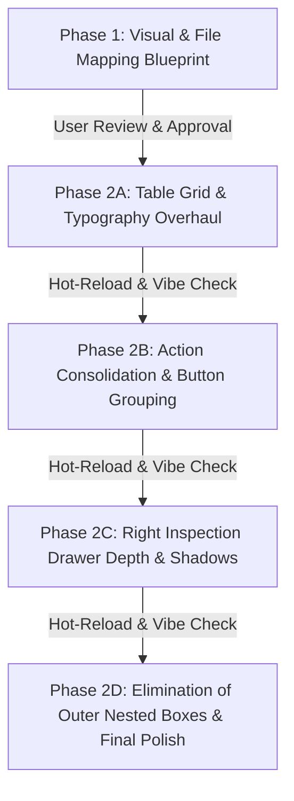

# UI/UX Enhancement Blueprint: Autonomous Refactoring Architecture

**Document Version**: 1.0.0  
**Target View**: Customer Case Workspace (`/cases/[id]`)  
**Design Standard**: Elite Tier-1 B2B Fintech SaaS (Anti-Slop Guardrails)  
**Status**: Pending Review & User Approval  

---

## 1. Executive Problem Analysis & Diagnosis

Inspection of the live Next.js customer case workspace (`https://branchmonitoring.thantowijauhari.com/cases/4be11631-d2f5-4d77-accc-91a29a137202`) and the screenshot reveals four core architectural UI/UX deficiencies:

```
┌────────────────────────────────────────────────────────────────────────┐
│ Current Anti-Pattern: Extreme "Nested Card Isolation" & Scattered Buttons│
├────────────────────────────────────────────────────────────────────────┤
│ [Outer Shell Canvas: #f8fafc]                                          │
│  ┌─ [Executive Card #1: border, rounded-lg, shadow-sm] ───────────────┐│
│  │   Customer Info + [Download Excel (v3) - GREEN] + [PDF] + [Upload] ││
│  │   ┌─ [Pipeline Card: border, bg-slate-50] ──────────────────────┐  ││
│  │   │  [Step 1 Card] [Step 2 Card] [Step 3 Card] [Step 4 Card]     │  ││
│  │   └─────────────────────────────────────────────────────────────┘  ││
│  └────────────────────────────────────────────────────────────────────┘│
│  ┌─ [Official Kertas Kerja Card #2: border, rounded-lg, shadow-sm] ────┐│
│  │   [Download Excel (XLSX) - GREEN] + [Download PDF] + [View Full]   ││
│  └────────────────────────────────────────────────────────────────────┘│
│  ┌─ [Document Package Card #3: border, rounded-lg] ───────────────────┐│
│  │   [Export Excel] + [Add Supp Doc]                                  ││
│  │   ┌─ [Doc 1 Card] ┌─ [Doc 2 Card] ┌─ [Doc 3 Card] ┌─ [Doc 4 Card]   ││
│  └────────────────────────────────────────────────────────────────────┘│
│  ┌─ [Active Document Card #4: border, rounded-lg] ────────────────────┐│
│  │   ┌─ [Table Card] ───────────────┐ ┌─ [Evidence Drawer Card] ─────┐││
│  │   │ Document Field | Value       │ │  ┌─ [Value Card] ────────┐  │││
│  │   │ Kota Makassar  | Makassar    │ │  └───────────────────────┘  │││
│  │   │                              │ │  ┌─ [Crop Card] ─────────┐  │││
│  │   │                              │ │  └───────────────────────┘  │││
│  │   └──────────────────────────────┘ └─────────────────────────────┘││
│  └────────────────────────────────────────────────────────────────────┘│
└────────────────────────────────────────────────────────────────────────┘
```

### Critical Flaws Identified:
1. **Severe Card-in-Card Nesting Fatigue**:
   - The user is trapped in 5 tiers of nested white boxes with gray borders (`border-slate-200`). This visual clutter creates heavy cognitive load, eats away horizontal whitespace, and distracts from core auditing tasks.
2. **Scattered Action Buttons & Green Key Devaluation**:
   - There are **four separate "Excel" buttons** on the screen simultaneously:
     - Top Executive Header: `Download Excel (v3)` (Primary Green)
     - Work Paper Panel: `Download Excel (XLSX)` (Primary Green)
     - Document Package Toolbar: `Export Excel` (Secondary)
     - Document Detail Header: `Copy to Excel` (Secondary)
   - Primary high-intent green (`#16a34a`) has lost its semantic authority due to repetitive placement.
3. **Typography & Low Header Contrast**:
   - Table and drawer column headers use weak slate-600/700 with inconsistent sizing (12px/13px), lacking the crisp, compact micro-scale of elite fintech platforms (Stripe, Ramp, Linear, Retool).
4. **Flat Evidence Drawer (No Layered Depth)**:
   - The right-hand "DOCUMENT SOURCE EVIDENCE" inspector shares the exact same stark white background and flat border as the table, failing to establish visual focus or spatial depth.
5. **Primitive Status Badges**:
   - Raw saturated badges (`OK`, `SOP_ERROR`, `NEEDS_CLASSIFICATION`) shout at the user instead of providing subtle, scan-friendly cues.

---

## 2. Component & File Mapping in Next.js Codebase

The following 4 codebase components directly generate this view and require targeted style and structure overrides:

| File Path | Component Name | Line Range | Responsibilities | Required Style Overrides |
| :--- | :--- | :--- | :--- | :--- |
| `frontend/app/cases/[id]/page.tsx` | `CasePage` (Executive Header & Pipeline) | `L260 - L360` | Header card, title, badges, action row, 4-step pipeline | Remove outer card box; switch to clean horizontal divider; consolidate top download actions into unified dropdown; flatten pipeline into borderless horizontal tracker |
| `frontend/app/cases/[id]/page.tsx` | `renderReportSection` | `L177 - L240` | Official Kertas Kerja Work Paper panel | Remove duplicate download buttons; unify with header report state; render as an integrated compliance status bar rather than an isolated chunky card |
| `frontend/app/cases/[id]/page.tsx` | `Customer Document Package` strip | `L545 - L680` | Document selector buttons, upload triggers | Remove outer white container box; convert into a sleek, borderless document tab carousel / segmented strip |
| `frontend/components/field-evidence-workspace.tsx` | `FieldEvidenceWorkspace` (Data Table & Inspection Drawer) | `L420 - L860` | Main extraction table (4 columns), filter chips, and right-hand evidence inspector drawer | Override `<th>` to `text-[11px] font-bold uppercase tracking-wider text-slate-400`; crisp `text-sm text-slate-700` cells; upgrade right inspector with `bg-slate-50/60`, `backdrop-blur-sm`, and sub-pixel edge shadow |
| `frontend/app/globals.css` | Global Design Tokens & Workspace Classes | `L4050 - L4350` | Layout split, side-by-side table, crop viewer, inspector heads | Purge card borders; implement soft-tone status variables (`bg-emerald-50 text-emerald-700`, `bg-amber-50 text-amber-700`, `bg-rose-50 text-rose-700`) |

---

## 3. The Anti-Slop Design Token Specification

### 3.1 Design Tokens

| Property | Current Value | Target Elite Fintech Token | Purpose |
| :--- | :--- | :--- | :--- |
| **Canvas Background** | `#ffffff` / `#edf4f2` | `bg-slate-50/40` (`#f8fafc`) | Soft, glare-free workspace backdrop |
| **Table Header Typography** | `12px font-semibold text-slate-700` | `text-[11px] font-bold uppercase tracking-wider text-slate-400/90` | Rapid scanning hierarchy, eliminates eye fatigue |
| **Table Data Typography** | `12px text-slate-800` | `text-[13px] font-medium text-slate-700 leading-snug` | High-legibility data reading |
| **Section Dividers** | `1px solid #cbd5e1` (heavy box borders) | `border-b border-slate-100` (`#f1f5f9`) | Boundary definition without nested box prisons |
| **Inspection Drawer Background** | `#fbfdfd` (flat opaque) | `bg-slate-50/60 backdrop-blur-sm` | Atmospheric distinction between primary data & evidence |
| **Inspection Drawer Shadow** | `none` (flat border) | `shadow-[-4px_0_24px_rgba(15,23,42,0.015)]` | Spatial layer elevation |
| **Primary Action Key** | Scattered across 4 buttons | **Protected Single Primary**: `#16a34a` (Emerald-600) | Reserved exclusively for primary document release / final action |
| **Secondary & Utilities** | Random borders & fills | `text-slate-600 hover:text-slate-900 hover:bg-slate-100/80 ghost/borderless` | Quiet background utility footprint |

### 3.2 Status Badge Color Harmonization

```
[PASS / OK / Compliant]  →  bg-emerald-50  text-emerald-700  border border-emerald-200/60  font-semibold text-xs px-2 py-0.5 rounded-md
[REVIEW / Attention]    →  bg-amber-50    text-amber-700    border border-amber-200/60    font-semibold text-xs px-2 py-0.5 rounded-md
[FAIL / Not Compliant]  →  bg-rose-50     text-rose-700     border border-rose-200/60     font-semibold text-xs px-2 py-0.5 rounded-md
[STP / Auto-Inferred]   →  bg-sky-50      text-sky-700      border border-sky-200/60      font-semibold text-xs px-2 py-0.5 rounded-md
```

---

## 4. Phase-by-Phase Execution Plan



### Phase 2A: Data Table Grid & Typography Headers
- Update `field-evidence-workspace.tsx` and `globals.css`:
  - Transform table header row to `text-[11px] font-bold uppercase tracking-wider text-slate-400/90` with zero heavy vertical borders.
  - Refine table row padding to `py-3 px-4`, removing zebra clutter and replacing row borders with micro `border-b border-slate-100`.
  - Format cell values with crisp `text-slate-700 text-sm` and soft-tone status tags.
  - Test live via Next.js hot-reload; verify column alignment.

### Phase 2B: Action Consolidation & Button Wrapper Streamlining
- Update `frontend/app/cases/[id]/page.tsx`:
  - Consolidate the two large green "Download Excel" buttons into **one protected primary action** in the Executive Action Bar.
  - Replace repetitive secondary exports with a unified **Export & Reports** dropdown menu (`Download Official XLSX`, `Download Audit PDF`, `Export Normalized JSON`).
  - Convert document-level actions (`Copy to Excel`, `Reprocess Specific Fields`, `Move Case`) into sleek, unified ghost action pills (`hover:bg-slate-100`).

### Phase 2C: Right Evidence Drawer Depth & Atmospheric Hierarchy
- Update `field-inspector-pane` styling in `field-evidence-workspace.tsx` and `globals.css`:
  - Apply `bg-slate-50/60`, `backdrop-blur-sm`, and `border-l border-slate-200/80`.
  - Add atmospheric elevation: `box-shadow: -4px 0 24px rgba(15, 23, 42, 0.02)`.
  - Redesign the "NILAI TERBACA EFEKTIF" box from a stark white rounded rectangle into an integrated flat panel with a clean accent hairline.
  - Upgrade the crop preview viewport with clean corner rounding (`rounded-lg`), subtle checkerboard canvas for transparent stamps, and zoom micro-controls.

### Phase 2D: Eliminate Nested Card Isolation (Outer Enclosures)
- Remove the redundant white card wrappers enclosing:
  - The Executive Header
  - The Stepper Pipeline
  - The Document Package selector
- Transition from "cards-inside-cards" to a seamless modern layout: clean section spacing (`mb-6`), subtle hairline dividers (`border-slate-100`), and borderless pill selectors.

---

## 5. Ready for User Review

This blueprint outlines the complete refactoring roadmap to achieve visual calm, data density, and tier-1 B2B fintech polish.

**Awaiting user approval before proceeding to Phase 2 implementation.**
